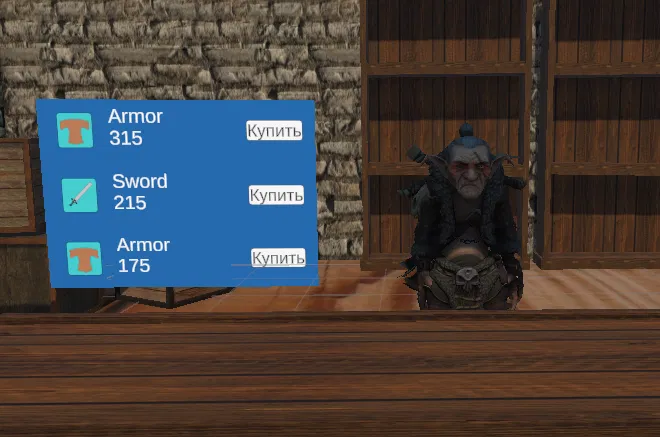
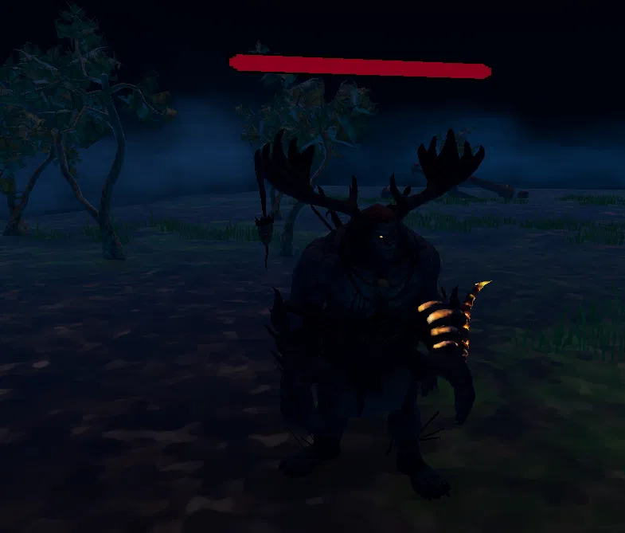

[English](README.md) | [Русский](README.ru.md)

# Adventurer's Path

***This project is no longer maintained. Launch errors and compatibility issues with current versions of Meta Quest Link and drivers are possible.***

- **Type:** individual project
- **Tech stack:** Unity 2021.3.12f1, XR Interaction Toolkit, OpenXR, A* Pathfinding Project, TextMeshPro
- **Platform:** Windows (PC VR for Meta Quest 2 via Quest Link / Air Link, OpenXR)

## Description

My first project made as part of my studies. A small demo that includes a main menu, an "Adventurers' Guild" location, and a "Forest" location for the "monster hunting" quest. It features three NPCs (a guild worker and two merchants) and three monsters to defeat. The main focus was on gameplay systems; graphics and UI are simplified.

## Screenshots

|  |  |
|---|---|
| Shop with a generated selection of goods | Enemy in the forest location |

## Strengths

1. **Well-developed internal game systems:**
   - items in different categories: "Default", "Consumable" and "Equipment", with their own stats and bonuses, built from ScriptableObject templates;
   - inventory with item equipping;
   - character stats system with leveling up and stat point distribution;
   - "adventurer rank" progression through completing quests;
   - shops with generated goods based on the player's total power;
   - enemies with AI (roaming and chasing using A*), weapon damage, health bars and item drops;
   - procedural generation of items with stat bonuses dropped by enemies, based on the monster's "power budget". The number and values of bonuses are random but follow weights, and the price depends on the bonuses.
2. **Complete game loop.** Within the demo: menu, new game or load, guild, NPC dialogue that depends on `PlayerQuestState`, quest, reward or penalty, rank growth.
3. **VR implementation:** a sword sheath, so the player doesn't have to hold the weapon all the time; switching between teleport and grab rays; separate grip points for each hand for correct item positioning.

## Demo limitations

1. Tightly coupled code and insufficient optimization.
2. Unpolished locations: small spaces, poorly chosen textures, simplified UI.
3. Some player stats have no effect in the game, except for being used when generating shop items. (Example: Luck should affect item drops, but this was not implemented due to lack of time.)

## Assets and credits

This project is non-commercial and was created for educational purposes. Rights to third-party materials belong to their authors.

- [A* Pathfinding Project](https://arongranberg.com/astar/) – Aron Granberg
- [Mega Fantasy Props Pack](https://assetstore.unity.com/packages/3d/environments/fantasy/mega-fantasy-props-pack-87811) – karboosx
- [Blacksmith's Forge](https://assetstore.unity.com/packages/3d/environments/fantasy/blacksmith-s-forge-17785) – 3DForge
- [Seven Swords](https://assetstore.unity.com/packages/3d/props/weapons/seven-swords-v2-7-free-pbr-swords-14304) – Perpetual Diversion
- [Ancient Ruins and Plants](https://assetstore.unity.com/packages/3d/props/exterior/ancient-ruins-and-plants-201914) – Comeback
- Hand models – Oculus Integration (Meta)
- Characters and animations (Brute, Eve, Goblin D Shareyko, Maw J Laygo) – Mixamo
- XR Interaction Toolkit, TextMeshPro – Unity Technologies

If you are the author of any asset and would like to correct the credit or have the material removed from the build, please contact me through the Issues of this repository.

## How to run

Download the archive from [Releases](https://github.com/Retrokot-dev/Adventurers-path/releases), unzip it, connect your Quest 2 via Quest Link or Air Link, and run `OpenXR.exe`. A Windows PC with a VR-ready graphics card and the Meta Quest Link app (with Meta Quest Link set as the active OpenXR runtime) is required.