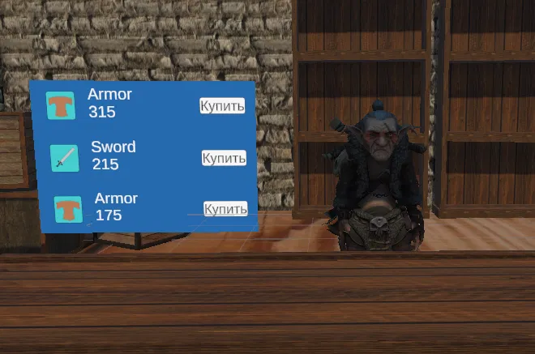
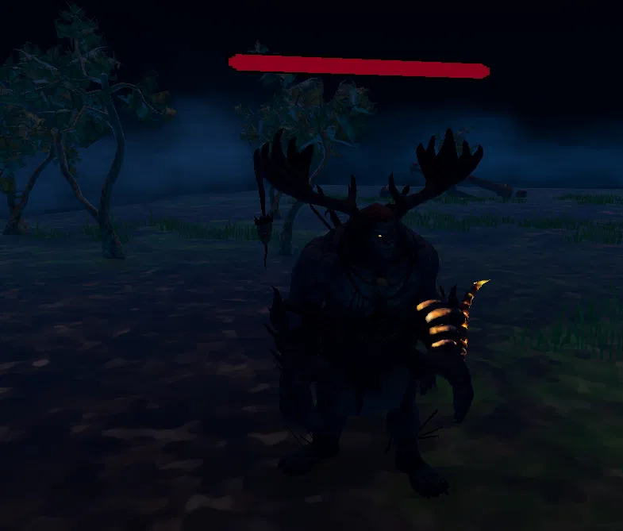

[English](README.md) | [Русский](README.ru.md)

# Adventurer's Path

***Проект не поддерживается. Возможны ошибки запуска и проблемы совместимости с актуальными версиями Meta Quest Link и драйверов.***

- **Тип:** индивидуальный проект
- **Стек технологий:** Unity 2021.3.12f1, XR Interaction Toolkit, OpenXR, A* Pathfinding Project, TextMeshPro
- **Платформа:** Windows (PC VR для Meta Quest 2 через Quest Link / Air Link, OpenXR)

## Описание

Первый проект в рамках обучения. Небольшое демо, включающее в себя главное меню, локацию «Гильдия авантюристов» и локацию «Лес» для выполнения задания «Убийство монстров». Включает в себя трёх NPC (работника гильдии и двух торговцев) и трёх противников-монстров для убийства. Основной упор сделан на геймплейные системы, графика и интерфейс упрощены.

## Скриншоты

|  |  |
|---|---|
| Магазин со сгенерированным ассортиментом | Противник в локации «Лес» |

## Положительные стороны

1. **Достаточно проработанные внутренние системы игры:**
   - предметы с различными категориями: «Default», «Consumable» и «Equipment», обладающие собственными характеристиками и бонусами и созданные на основе шаблонов ScriptableObject;
   - инвентарь с возможностью экипировки предметов;
   - система характеристик персонажа с возможностью повышения уровня и распределения очков характеристик;
   - повышение «рейтинга авантюриста» через выполнение заданий;
   - магазины с генерацией предметов в зависимости от общей силы игрока;
   - противники с ИИ (блуждание и преследование на основе A*), урон оружием, полоски здоровья, выпадение предметов;
   - процедурная генерация предметов с бонусами к характеристикам, выпадающих с врагов, на основе «бюджета силы» монстра. Число и значения бонусов случайны, но подчиняются весам, цена зависит от бонусов.
2. **Продуман замкнутый игровой цикл.** В рамках демо: меню, новая игра или загрузка, гильдия, диалог с NPC, зависящий от `PlayerQuestState`, квест, награда или штраф, рост ранга.
3. **Реализована работа с VR:** ножны для меча, чтобы игроку не нужно было постоянно держать оружие в руках; переключение лучей телепортации и захвата предметов; точки удержания предметов для разных рук для правильного позиционирования.

## Ограничения демо-версии

1. Сильная связанность и недостаточная оптимизация кода.
2. Непроработанные локации: маленькие пространства, плохо подобранные текстуры, упрощённый интерфейс.
3. Часть характеристик игрока не имеет реализации в игре, за исключением учёта при генерации предметов в магазине. (Пример: удача должна влиять на выпадение предметов, однако функционал не добавлен за неимением достаточного времени.)

## Ассеты и благодарности

Проект некоммерческий, создан в учебных целях. Права на сторонние материалы принадлежат их авторам.

- [A* Pathfinding Project](https://arongranberg.com/astar/) – Aron Granberg
- [Mega Fantasy Props Pack](https://assetstore.unity.com/packages/3d/environments/fantasy/mega-fantasy-props-pack-87811) – karboosx
- [Blacksmith's Forge](https://assetstore.unity.com/packages/3d/environments/fantasy/blacksmith-s-forge-17785) – 3DForge
- [Seven Swords](https://assetstore.unity.com/packages/3d/props/weapons/seven-swords-v2-7-free-pbr-swords-14304) – Perpetual Diversion
- [Ancient Ruins and Plants](https://assetstore.unity.com/packages/3d/props/exterior/ancient-ruins-and-plants-201914) – Comeback
- Модели рук – Oculus Integration (Meta)
- Персонажи и анимации (Brute, Eve, Goblin D Shareyko, Maw J Laygo) – Mixamo
- XR Interaction Toolkit, TextMeshPro – Unity Technologies

Если вы автор какого-либо ассета и хотите уточнить указание авторства или удалить материал из сборки, свяжитесь со мной через Issues этого репозитория.

## Запуск

Скачайте архив из [Releases](https://github.com/Retrokot-dev/Adventurers-path/releases), распакуйте, подключите Quest 2 через Quest Link или Air Link и запустите `OpenXR.exe`. Требуется Windows ПК с VR-совместимой видеокартой и приложение Meta Quest Link (с выбранным Meta Quest Link в качестве активного OpenXR runtime).
